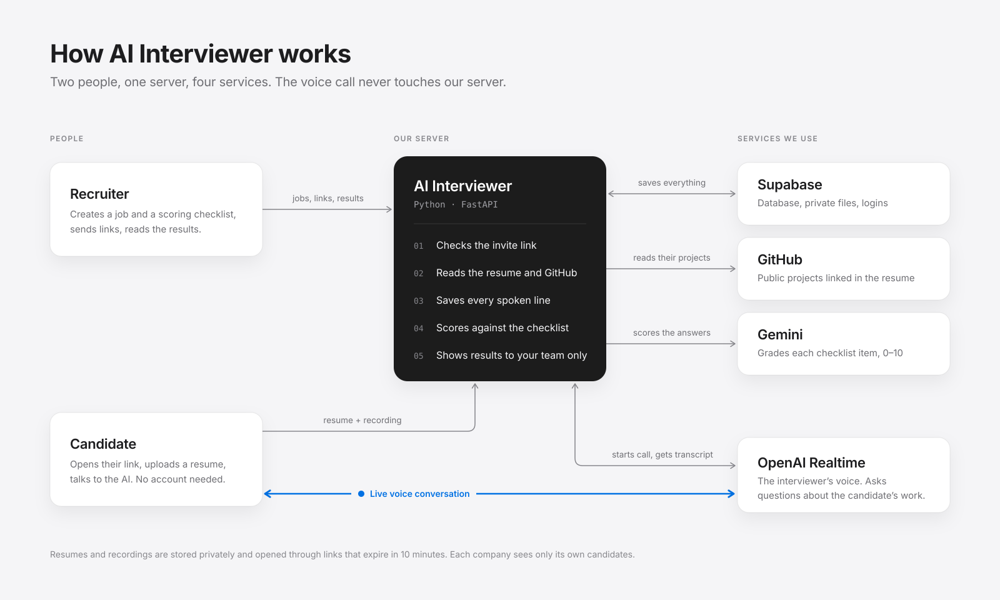

<p align="center">
  
</p>

<h1 align="center">AI Interviewer</h1>

<p align="center">
  <b>Job interviews that run themselves.</b><br>
  Send a link. The AI does the interview. You get the score.
</p>

<p align="center">
  <a href="video/ai-interviewer.mp4">▶ Watch the video</a> ·
  <a href="#-try-it-in-5-minutes">Try it</a> ·
  <a href="#-questions">Questions</a>
</p>

<p align="center">
  <a href="video/ai-interviewer.mp4"></a>
</p>

---

## 👋 Meet AI Interviewer

Hiring takes forever. Calls get scheduled, then moved, then missed. One person takes notes, someone else forgets to. Everyone scores differently.

**AI Interviewer handles the first-round interview for you.**

Your candidate clicks a link and talks to an AI interviewer, out loud, like a normal video call. Then a score, a short report and the full recording show up in your dashboard.

You don't schedule anything or sit in the call.

---

## ✨ How it works

### 1. Create a job
Type the job title and write down what you care about. For example:

> System design **40%** · Python **30%** · Communication **20%** · Ownership **10%**

That's your scoring checklist. Every candidate is judged on it.

### 2. Send a link
Type the candidate's name and email, then click **Create link**. Each candidate gets their own private link.

- No account needed for the candidate
- Works once
- Expires after 7 days

### 3. They talk, the AI listens
The candidate opens the link, uploads their resume and starts talking.

The AI has **already read their resume and GitHub**, so it asks about *their* work:

> *"I saw the rate limiter in your queue-kit repo. Why did you choose a token bucket?"*

### 4. You get the answer
When they finish, you see:

| | |
|---|---|
| 🎯 **Overall score** | One number out of 100 |
| 📋 **Checklist scores** | 0–10 for each item, with the exact words that earned it |
| 💪 **Strengths and weaknesses** | A few plain sentences |
| 🎥 **Recording** | Watch the whole interview |
| 📝 **Transcript** | Read every question and answer |

The candidate never sees their score. Only your team does.

---

## 💡 Why you'll like it

**If you hire people**
- Interview 50 candidates in the time it takes to schedule 5
- Everyone gets the same checklist, so scores are fair and easy to compare
- Watch the recording only when you need to

**If you're the candidate**
- Interview when it suits you, at 9am or midnight
- Nothing to download and no account to make
- Questions about your real work, not trick puzzles

**If you're on the team**
- The account owner invites you by email
- Everyone sees the same jobs and candidates

---

## 🚀 Try it in 5 minutes

You'll need these four things (all have free tiers or are cheap to start):

- [Python 3.10 or newer](https://www.python.org/downloads/)
- A [Supabase](https://supabase.com) account (stores your data)
- An [OpenAI API key](https://platform.openai.com/api-keys) (the interviewer's voice)
- A [Gemini API key](https://aistudio.google.com/apikey) (does the scoring)

**Step 1: Download and install**
```bash
git clone https://github.com/siddhunangadi/ai-interviewer.git && cd ai-interviewer
```
```bash
python3 -m venv .venv && .venv/bin/pip install -r requirements.txt
```

**Step 2: Set up the database**
In Supabase, open **SQL Editor**, paste everything from [`schema.sql`](schema.sql), and click **Run**.

**Step 3: Add your keys**
```bash
cp .env.example .env
```
Open `.env` and paste in your keys. Each line says where to find that key.

**Step 4: Start it**
```bash
.venv/bin/uvicorn main:app --reload --port 8000
```

**Step 5: Try it**
Open **http://localhost:8000** → **Sign up** → create a job → send yourself a link → do an interview. 🎉

<details>
<summary><b>Getting ready for real users? (3 quick settings)</b></summary>

<br>

In Supabase, go to **Authentication**:

1. **URL Configuration:** set the Site URL to your website address and add `https://your-site.com/**` to Redirect URLs. (For testing on your computer, use `http://localhost:8000`.)
2. **Emails:** Supabase's built-in email only sends a few emails an hour. Connect a real email service (Resend, Amazon SES, Postmark…) under **SMTP Settings**. Just testing? Turn off **Confirm email** instead.
3. **Google sign-in (optional):** turn on **Google** under Sign In / Providers. The "Continue with Google" button appears by itself.

</details>

---

## ❓ Questions

**Is it fair to candidates?**
Everyone applying for the same job is scored on the same checklist. If you change the checklist later, old scores don't change.

**Who can see the results?**
Only your company's team. Other companies can't see your candidates. Resumes and recordings are stored privately.

**Does the candidate need to sign up?**
No. They just click the link.

**How long is an interview?**
Short. The AI asks 3 to 5 questions, one at a time. Recordings can be up to about 20 minutes.

**Does the AI make the hiring decision?**
No. It gives you a score and the evidence behind it. You decide.

**What does the candidate need?**
A microphone and a web browser. Chrome, Edge or Safari work best.

---

## 🛠 Under the hood



Built with **FastAPI** (Python) · **Supabase** (database, files, login) · **OpenAI Realtime** (voice) · **Gemini** (scoring) · plain **HTML, CSS and JavaScript**.

<p align="center"><sub>Create a job. Send a link. Read the results.</sub></p>
